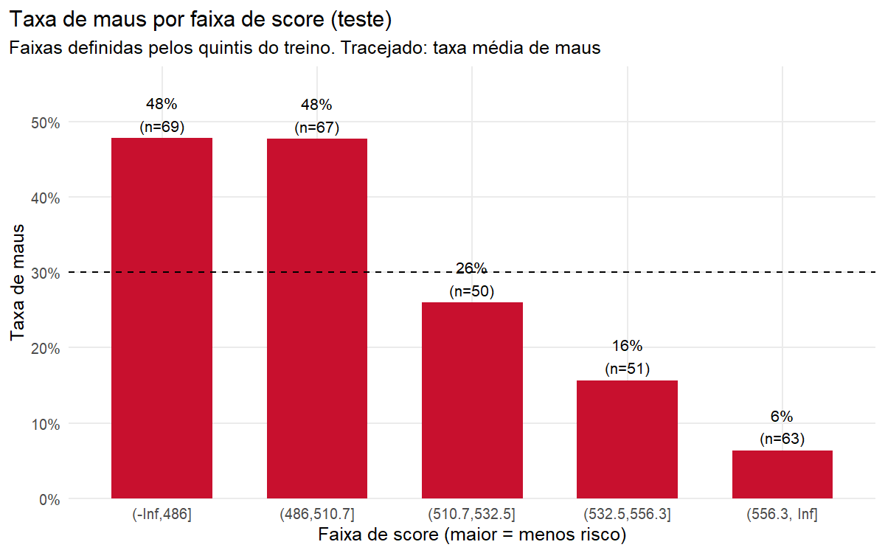
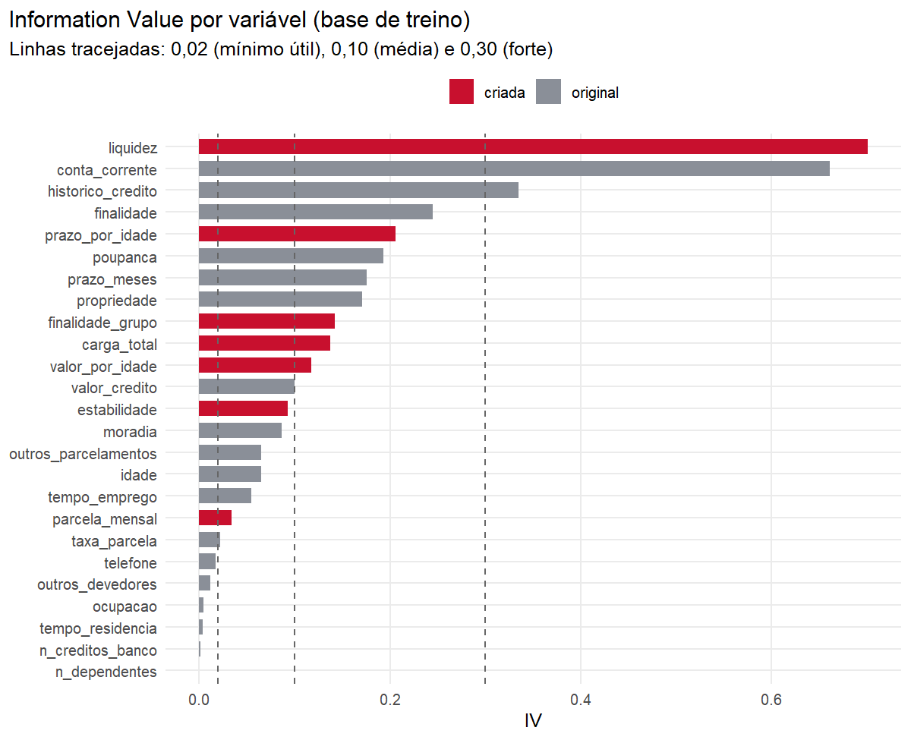
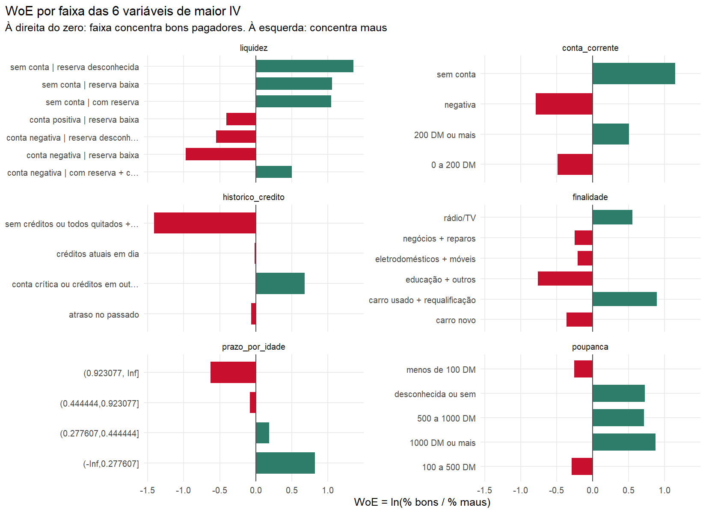
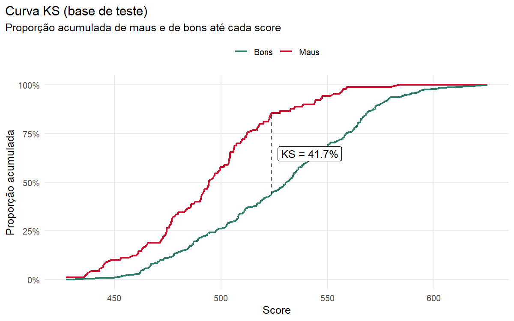

# Credit scoring com regressão logística, WoE/IV e KS

Modelo de risco de crédito na base pública **German Credit** (UCI, 1.000 contratos, 30% de maus pagadores), feito em R. O projeto cobre o ciclo completo de um scorecard: tratamento dos dados, criação de variáveis, binning com WoE, seleção por IV, regressão logística, avaliação por AUC e KS e conversão em pontos.

WoE, IV, KS e PSI estão implementados à mão em [`R/00_funcoes.R`](R/00_funcoes.R), sem pacote de scorecard, para que cada número possa ser explicado.

## Resultado em uma tela

| Métrica | Treino (700) | Teste (300) | IC 95% no teste (bootstrap) |
|---|---|---|---|
| AUC | 0,811 | **0,736** | 0,679 a 0,795 |
| Gini | 0,623 | 0,472 | |
| KS | 49,0% | **41,7%** | 33,7% a 52,8% |

Validação cruzada no treino (5 dobras × 10 repetições): AUC 0,766 e KS 45,9%. PSI do score entre treino e teste: 0,034 (estável).

O score ordena o risco: no teste, a faixa de menor score tem 48% de maus e a de maior score tem 6%, contra 30% na média.



**Achado principal sobre criação de variáveis:** as 7 variáveis que criei têm bom poder individual (4 delas com IV acima de 0,10, e `liquidez` com o maior IV da base), mas **não melhoraram o modelo**. Na validação cruzada, o modelo com elas ficou 0,004 de AUC abaixo do modelo só com as originais e venceu em 1 de 10 repetições. Pela regra definida antes de abrir o teste, o modelo final usa só as variáveis originais. A explicação está no passo 4.

## Como rodar

```r
install.packages(c("ggplot2", "pROC", "scales"))
```

```bash
Rscript run_all.R            # na raiz do projeto; leva cerca de 15 segundos
quarto render relatorio.qmd  # gera o relatório em HTML (opcional)
```

O relatório completo, com texto, tabelas e gráficos calculados a partir dos resultados, está em [`relatorio.qmd`](relatorio.qmd) (versão renderizada: `relatorio.html`). Para renderizar é preciso ter o [Quarto](https://quarto.org) e os pacotes `knitr` e `rmarkdown`.

```
R/00_funcoes.R     binning, WoE, IV, KS, AUC, PSI e o pipeline de treino
R/01_dados.R       leitura, dicionário de códigos, alvo, treino/teste
R/02_features.R    criação de variáveis e listas de variáveis
R/03_woe_iv.R      tabelas e gráficos de WoE e IV
R/04_modelo.R      validação cruzada e modelo final
R/05_avaliacao.R   métricas no teste, scorecard, PSI, gráficos
relatorio.qmd      relatório em Quarto (lê os resultados e gera o HTML)
output/            tabelas (.csv) e figuras (.png) geradas
```

---

## Passo a passo

### 1. Definir o problema e o alvo

O banco quer saber, **no momento do pedido**, a chance de o cliente virar mau pagador. Isso define duas coisas:

- **Alvo:** `mau = 1` se o contrato foi classificado como ruim (classe 2 na base), `0` caso contrário. A taxa de maus é 30%.
- **O que pode ser variável:** só informação disponível na hora da decisão. Todas as 20 variáveis da base atendem a isso.

Duas variáveis saíram antes de qualquer análise: `estado_civil_sexo` e `trabalhador_estrangeiro`. São atributos protegidos, e negar crédito com base neles é discriminação. Esse filtro vem antes da métrica: não importa quanto a variável discrimina. `idade` ficou porque é prática comum em crédito, mas é uma escolha discutível.

### 2. Separar treino e teste antes de olhar qualquer coisa

70% treino, 30% teste, sorteio estratificado (as duas partes ficam com exatamente 30% de maus). O teste é usado **uma vez**, no fim. Tudo o que "aprende" com os dados (faixas, WoE, escolha de variáveis, coeficientes) é ajustado só no treino. Se as faixas de WoE fossem calculadas na base inteira, o teste já teria vazado para dentro do modelo e as métricas sairiam otimistas.

### 3. Criar variáveis (feature engineering)

Um ponto que muda o que vale a pena criar: como o modelo trabalha com faixas, **transformação monótona de uma variável só não serve para nada**. `log(valor)` gera exatamente as mesmas faixas que `valor`. Só traz informação nova quem **combina** variáveis ou **reagrupa** categorias usando conhecimento de negócio. Criei sete:

| Variável | Construção | Hipótese |
|---|---|---|
| `parcela_mensal` | valor ÷ prazo | o que pesa no bolso é a parcela, não o total |
| `valor_por_idade` | valor ÷ idade | dívida grande cedo na vida é mais arriscada |
| `prazo_por_idade` | prazo ÷ idade | compromisso longo com pouco histórico |
| `carga_total` | taxa da parcela na renda × prazo | comprometimento sustentado por muito tempo |
| `liquidez` | conta corrente × poupança (interação) | conta negativa **e** sem reserva é pior que cada um sozinho |
| `finalidade_grupo` | 10 finalidades em 5 grupos | categorias pequenas são instáveis |
| `estabilidade` | emprego longo + casa própria + residência longa (0 a 3) | vínculos sinalizam estabilidade |

### 4. Medir o poder de cada variável: binning, WoE e IV

**Binning.** Cada variável é cortada em faixas. Numéricas começam em 5 faixas de mesmo tamanho (quintis); categóricas, com uma faixa por categoria. Depois, faixas com menos de 5% da amostra ou sem bons/maus são fundidas com a de taxa de maus mais parecida. Nas numéricas ainda exijo **monotonicidade**: a taxa de maus só pode subir ou só descer ao longo das faixas. Zigue-zague em amostra pequena quase sempre é ruído, e uma regra que não é monótona não se explica a um cliente ("por que pedir menos piorou meu score?").

**WoE (Weight of Evidence)** de uma faixa:

```
WoE = ln( % dos bons que estão na faixa / % dos maus que estão na faixa )
```

WoE positivo: a faixa concentra bons. Negativo: concentra maus. Zero: igual à média. Cada variável é então substituída pelo WoE da faixa. Isso resolve três problemas de uma vez: coloca tudo na mesma escala (log-odds, a escala natural da logística), trata não linearidade e absorve outliers sem precisar removê-los.

**IV (Information Value)** resume a variável inteira:

```
IV = soma, nas faixas, de (% bons − % maus) × WoE
```

Régua usual: abaixo de 0,02 inútil; 0,02 a 0,10 fraca; 0,10 a 0,30 média; 0,30 a 0,50 forte; acima de 0,50 "boa demais", vale investigar vazamento.



O que o ranking mostra:

- `conta_corrente` (0,66) e `liquidez` (0,70) passam de 0,50. Não é vazamento, porque o saldo em conta é conhecido na hora do pedido, mas o padrão é estranho: **"sem conta" é a categoria mais segura** (12% de maus). Em `historico_credito`, quem tem "todos os créditos quitados" é o pior grupo (64% de maus) e "conta crítica" é dos melhores. São peculiaridades conhecidas dessa base; a literatura (Grömping, 2019, *South German Credit Data*) aponta erros na documentação original dos códigos. Num projeto real, um WoE que contraria a lógica de negócio é motivo para parar e questionar o dado antes de modelar.
- 6 variáveis ficaram abaixo de 0,02 e são descartadas.
- Das criadas, `liquidez`, `prazo_por_idade`, `finalidade_grupo`, `carga_total` e `valor_por_idade` têm IV acima de 0,10.

**Então por que não melhoraram o modelo?** Porque IV mede a variável **sozinha**. `liquidez` é uma combinação de `conta_corrente` e `poupanca`; seu IV alto é, quase todo, o IV que as duas já entregavam. O que importa para o modelo é o ganho **incremental**, e esse só aparece comparando modelos (passo 6). Além disso, a base tem 20 atributos já resumidos por cliente. Criação de variáveis rende de verdade quando há dado bruto para agregar (transações, histórico de parcelas, consultas ao bureau), que é o caso de bases como a Home Credit.



### 5. Selecionar variáveis e ajustar a regressão logística

A seleção tem quatro filtros, nesta ordem:

1. **IV ≥ 0,02.**
2. **Correlação.** Entre duas variáveis com correlação acima de 0,7 (em WoE), fica a de maior IV. Variáveis redundantes deixam os coeficientes instáveis.
3. **Significância.** Eliminação para trás: sai a de maior p-valor até todas terem p < 0,05.
4. **Sinal.** Como WoE alto significa "mais bons" e o alvo é "mau", todo coeficiente tem de ser **negativo**. Sinal positivo indica que a variável está corrigindo outra, não medindo risco, e ela sai.

O modelo é:

```
ln( P(mau) / P(bom) ) = b0 + b1·WoE(x1) + ... + bk·WoE(xk)
```

Modelo final (8 variáveis, todas com sinal negativo e p < 0,05):

| Variável | Coeficiente | p-valor | IV |
|---|---|---|---|
| conta_corrente | −0,79 | < 0,001 | 0,661 |
| historico_credito | −0,84 | < 0,001 | 0,335 |
| finalidade | −1,00 | < 0,001 | 0,245 |
| poupanca | −0,78 | 0,001 | 0,193 |
| propriedade | −0,64 | 0,011 | 0,171 |
| valor_credito | −1,24 | < 0,001 | 0,100 |
| idade | −0,96 | 0,012 | 0,065 |
| taxa_parcela | −2,53 | < 0,001 | 0,022 |

Por que logística e não um boosting: em crédito o modelo precisa ser explicado ao regulador e ao cliente recusado, e na logística com WoE cada faixa vira um número de pontos. Com 1.000 linhas, modelos mais complexos também teriam pouco dado para justificar o ganho.

### 6. Testar se as variáveis criadas ajudam (validação cruzada)

Com 700 linhas de treino, um único corte treino/validação é ruído. Usei 5 dobras repetidas 10 vezes, e em cada dobra o pipeline inteiro (faixas, WoE, seleção, regressão) é refeito do zero. Os dois cenários usam as mesmas dobras, o que permite comparar par a par.

| Cenário | AUC médio | Desvio | KS médio | Desvio |
|---|---|---|---|---|
| A: só originais | 0,766 | 0,040 | 45,9% | 6,3 p.p. |
| B: originais + criadas | 0,762 | 0,035 | 44,9% | 4,8 p.p. |

B venceu A em AUC em 1 de 10 repetições. A regra, escrita no código antes de rodar o teste, era: as variáveis criadas só entram se B vencer em pelo menos 8 de 10. **Ficou o A.**

Repare no desvio: o KS varia mais de 6 pontos entre dobras. Qualquer diferença de 1 ou 2 pontos de KS nessa base é indistinguível de sorte.

### 7. Avaliar no teste: AUC, KS e ordenação

- **AUC (0,736):** sorteando um mau e um bom, é a probabilidade de o modelo dar mais risco ao mau. 0,5 é moeda, 1 é perfeito. **Gini = 2·AUC − 1** (0,472).
- **KS (41,7%):** a maior distância entre as curvas acumuladas de maus e de bons ao longo do score. No ponto de KS máximo, o modelo já separou a maior diferença possível entre "maus capturados" e "bons sacrificados".



- **Ordenação por faixa:** mais importante que o número único. Os 45% de menor score concentram 72% dos maus.

| Faixa de score | n | Maus | Taxa de maus | % maus acumulado |
|---|---|---|---|---|
| até 486 | 69 | 33 | 47,8% | 36,7% |
| 486 a 511 | 67 | 32 | 47,8% | 72,2% |
| 511 a 533 | 50 | 13 | 26,0% | 86,7% |
| 533 a 556 | 51 | 8 | 15,7% | 95,6% |
| acima de 556 | 63 | 4 | 6,3% | 100% |

As duas primeiras faixas têm a mesma taxa de maus: o modelo não distingue "ruim" de "muito ruim". É uma fraqueza real.

- **PSI (0,034):** compara a distribuição do score entre treino e teste. Abaixo de 0,10 é estável. Em produção, é o que se monitora mês a mês para saber quando o modelo envelheceu.

### 8. Transformar em scorecard

A probabilidade vira pontos por uma convenção de mercado: 600 pontos equivalem a 50 bons para 1 mau, e a cada 20 pontos a chance de ser bom dobra (PDO = 20).

```
fator  = PDO / ln(2)
offset = 600 − fator · ln(50)
score  = offset + fator · ln( P(bom) / P(mau) )
```

Como o modelo é linear em WoE, o score se decompõe em pontos por faixa ([`output/tabelas/scorecard.csv`](output/tabelas/scorecard.csv)). Exemplo: conta corrente "sem conta" vale 90 pontos e "negativa" vale 46. Somando os pontos das 8 variáveis chega-se ao score do cliente, e qualquer recusa pode ser explicada apontando as faixas que mais tiraram pontos.

---

## Limitações

- **Amostra pequena.** O teste tem 300 linhas e 90 maus. O intervalo do KS vai de 34% a 53%: o número pontual sozinho diz pouco.
- **Sobreajuste moderado.** AUC de 0,811 no treino contra 0,736 no teste (0,766 na validação cruzada). Parte vem do binning supervisionado em base pequena.
- **O teste foi visto mais de uma vez.** Durante o desenvolvimento, antes de a regra de escolha entrar no código, o cenário B foi avaliado no teste e fez AUC 0,759, acima do A (0,736). A diferença está dentro do intervalo de confiança e a escolha seguiu a validação cruzada, não o teste. Trocar para B por causa desse número seria justamente escolher o modelo pelo teste.
- **Sem dimensão temporal.** Modelo de crédito real é validado em safra posterior (out-of-time). A base não tem data.
- **Viés de seleção.** Só há clientes aprovados; quem foi recusado não aparece (o problema de *reject inference*).
- **Dados de 1994, em marcos alemães, com documentação questionada.** Serve para demonstrar método, não para conclusões sobre crédito.
- **Custo assimétrico ignorado.** A documentação da base sugere que aprovar um mau custa 5 vezes mais que recusar um bom. Isso afetaria o ponto de corte, que este projeto não define.

## Próximos passos

Repetir o pipeline na base Home Credit (307 mil contratos, tabelas de histórico de parcelas e bureau), onde criação de variáveis por agregação tem espaço para mostrar ganho, e comparar a logística com um gradient boosting como referência de teto.

## Dados

Statlog (German Credit Data), UCI Machine Learning Repository, doada por H. Hofmann. Licença CC BY 4.0.
